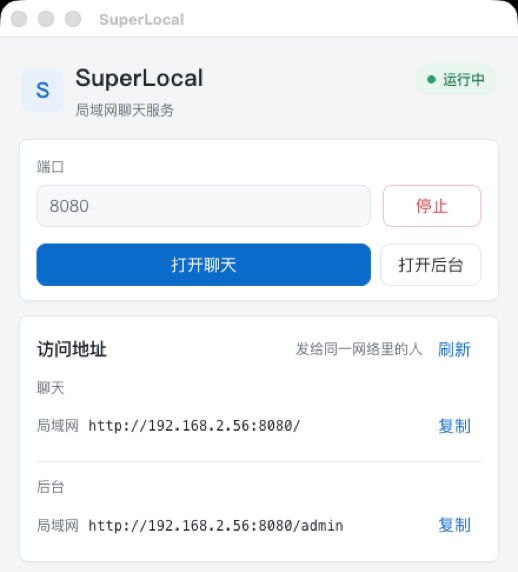
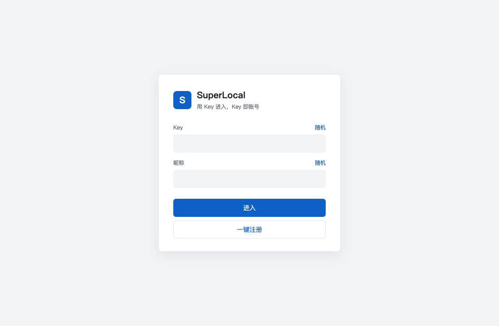
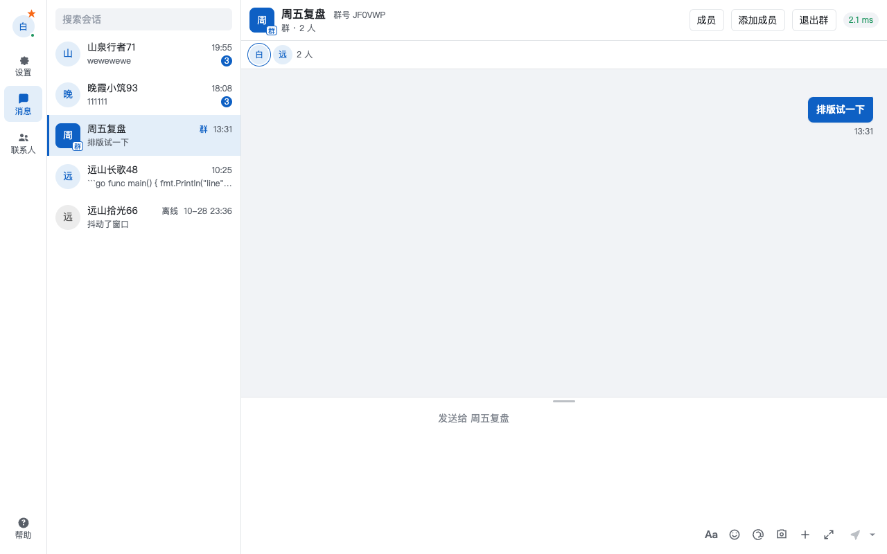
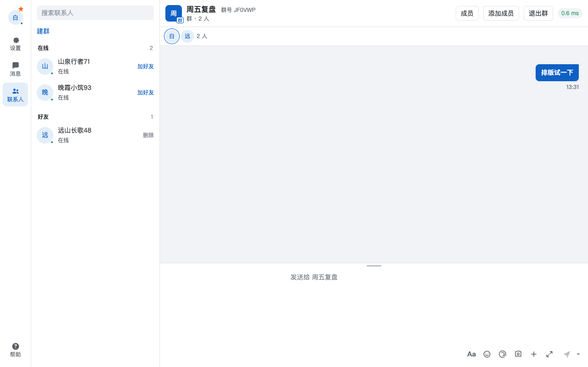

# SuperLocal

同一局域网里的即时聊天。打开桌面程序，点「启动」，把地址发给同一网络里的人。对方用浏览器就能进，不用再装别的软件。

## 使用

打开 **SuperLocal**。点「启动」。状态变成「运行中」之后，点「打开聊天」，或者复制「访问地址」里的聊天链接发到微信、飞书。



- **打开聊天**：在这台电脑的浏览器里进入。
- **打开后台**：只给跑服务的人用，管用户和群。
- **复制**：把聊天地址发给别人。别人必须和这台电脑在同一个网络。
- **刷新**：换了 IP 再点一次，地址会换成新的，不用重启。
- 关掉窗口会缩进托盘，服务继续跑。要停，打开窗口点「停止」。

管理员账号显示在窗口下半部分，只用于本机后台。

## 进聊天

第一次打开是这个页面。填 Key 和昵称，点「进入」。旁边的「随机」可以分别生成。底部「一键注册」会生成一组并直接登录。



Key 就是账号，没有单独的聊天密码。自己能看到自己的 Key，别人只看到昵称。每个浏览器窗口各自登录，再开一个窗口可以换一个账号。

## 聊天

左边是会话，右边是聊天。占位写着「发送给谁」。右上角是到服务器的延迟。



输入栏平时只有一行图标：

- **Aa**：加粗、删除线、斜体、下划线、列表、引用、链接、代码，还有字体、字号和颜色。
- **表情**：最常使用和默认表情。
- **@**：在群里选人，也可以直接打 `@`。
- **截图**：提取文字、滚动截图、录屏、截图。
- **+**：图片、文件、聊天记录、窗口抖动、屏幕取色。
- **发送**：旁边的小三角在 Enter 发送和 Ctrl+Enter 发送之间换。

输入区上沿可以上下拖。文字、图片、文件都能发，可以引用、回应表情，自己的消息 24 小时内能撤回。代码会显示成带行号的卡片。个人免打扰打开后，别人不能再发单聊，群聊不受影响。

手机和电脑都能开。窄屏上列表和聊天分成两屏，只有消息列表滚动。

## 联系人

点左侧「联系人」。在线的人可以直接聊天，也可以加好友，对方同意后出现在好友里。



头像、个性签名、挂件和消息提醒在左上角的设置里。左下角是帮助。

## 特点

- 浏览器就是客户端，手机、平板、电脑用同一个地址。
- 消息和文件经过这台电脑转发，不出这个局域网。
- 每个窗口一个账号，互不顶掉。
- 消息保留 48 小时。单个文件默认最大 200MB。

## 从源码编译

日常使用不需要这一节。只有自己改代码、重新打包时才用。需要 Go，以及 Node 24。

```bash
export PATH="/usr/local/opt/node@24/bin:$PATH"
cd web && npm install && npm run build
cd ..
CGO_ENABLED=0 go build -o desktop/binaries/superlocal ./cmd/superlocal
cd desktop && npm install && npm start
```

`npm start` 打开的就是上面那个管理窗口。macOS 安装包在 Mac 上执行 `npm run pack`，Windows 安装包在 Windows 上打。安装包没有签名，第一次打开时按系统提示允许。

也可以不经过桌面程序，在仓库根目录执行：

```bash
CGO_ENABLED=0 go build -o superlocal ./cmd/superlocal
./superlocal -addr :8080 -data ./data -max-upload 200MB
```

终端会打印聊天地址、后台地址和管理员密码。
