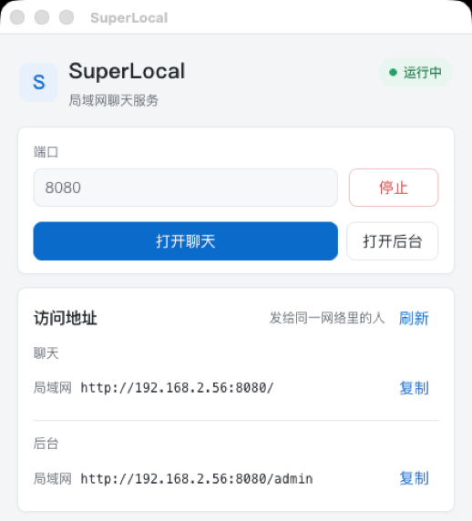
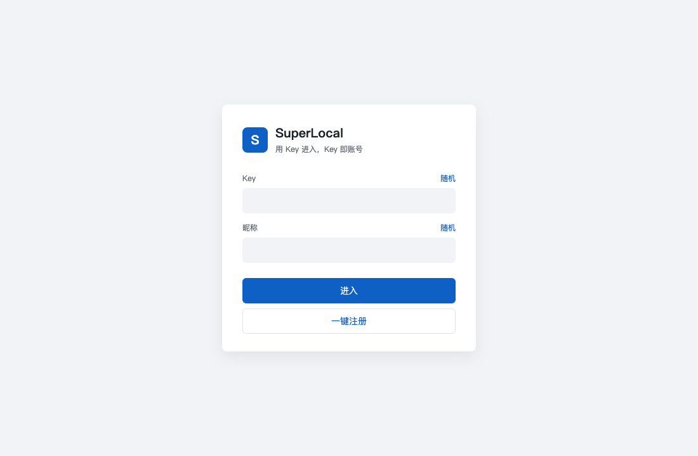
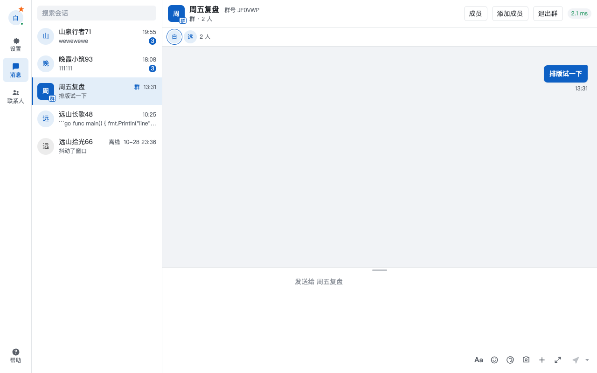
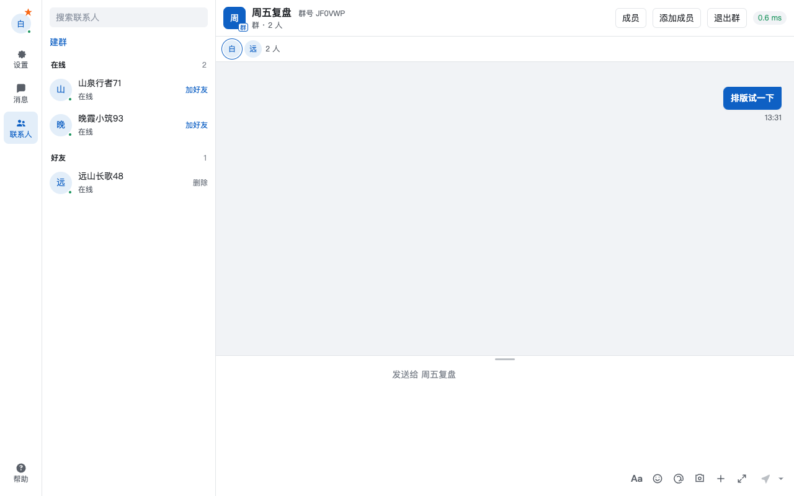

# SuperLocal

跨设备、跨平台传东西。一台电脑开着服务，手机、平板、Windows、macOS 用浏览器打开同一个地址，就能互发消息和文件，也能一对一打语音、打视频、共享屏幕。

不用给每台设备装客户端。教室、办公室、家里，连着同一个网络即可。内容由这台电脑转发，不经过外面的服务器。

## 特点

**手机和电脑是同一个入口。** 地址发到微信或飞书，iPhone、安卓、Windows、macOS 点开都能进。每个浏览器窗口一个账号，互不顶掉。

**消息和文件直接传。** 文字、图片、文件走这台电脑转发。单文件默认最大 200MB，消息保留 48 小时。换了网络，刷新一下，链接换成新地址。

**想说话就打语音。** 单聊点一下即可呼叫。对方接听后可以静音、挂断。无人接听大约 30 秒结束，对方正在通话会提示忙线。

**想见面就开视频。** 同一条单聊可以改用视频，麦克风和摄像头一起开。能直连就直连；设备被路由器隔开时，由这台电脑把音视频转过去。对方关掉摄像头，画面改成昵称。

**想给对方看屏幕就共享。** 单聊里先发出请求，对方接受后，你再选择屏幕或窗口。对方只能看，不能操作你的电脑。共享和语音、视频可以同时进行。

## 使用

### 桌面程序

打开 SuperLocal，点「启动」。状态变成「运行中」之后，点「打开聊天」，或复制「访问地址」里的链接发给同一网络里的人。



- **打开聊天**：在这台电脑的浏览器里进入。
- **打开后台**：只给跑服务的人用，管理用户和群。
- **复制**：把聊天地址发给别人。对方必须和这台电脑在同一个网络。
- **刷新**：换了 IP 再点一次，地址会换成新的，不用重启。
- **数据目录**：服务停止时可以改。确认后，数据库、上传文件和证书会整份搬到新目录。目标目录里已经有别的文件时不会搬。
- 关掉窗口会缩进托盘。要停，打开窗口点「停止」。

同一个端口同时提供 `https://` 和 `http://`。`https://` 才能语音、视频和共享屏幕。`http://` 可以聊天、传文件和打开后台，包括 `http://127.0.0.1`，没有这三项。第一次用浏览器打开 `https://` 地址时，系统会提示证书不受信任。这是程序在本机签发的证书，选择继续访问即可。换了局域网 IP 以后证书会重新生成，需要再接受一次。不想处理证书时，把地址里的 `https://` 改成 `http://` 即可。

管理员账号显示在窗口下半部分，只用于本机后台。

macOS 安装包没有签名。第一次打开如果被拦截，在「系统设置 → 隐私与安全性」里允许，或按住 Control 再点「打开」。

### 从源码运行

日常使用不需要这一节。改代码或重新打包时需要 Go，以及 Node 24。

```bash
export PATH="/usr/local/opt/node@24/bin:$PATH"
cd web && npm install && npm run build
cd ..
CGO_ENABLED=0 go build -o desktop/binaries/superlocal ./cmd/superlocal
cd desktop && npm install && npm start
```

`npm start` 打开的就是上面那个管理窗口。macOS 安装包在 Mac 上执行 `npm run pack`，Windows 安装包在 Windows 上打。

也可以不经过桌面程序，在仓库根目录执行：

```bash
CGO_ENABLED=0 go build -o superlocal ./cmd/superlocal
./superlocal -addr :8080 -data ./data -max-upload 200MB
```

终端会打印聊天地址、后台地址和管理员密码。前面已经有反向代理负责 TLS 时，加上 `-tls=false`，此时程序只提供 HTTP，也不提供通话。

## 功能

### 进入聊天

第一次打开时填写 Key 和昵称，点「进入」。旁边的「随机」可以分别生成。底部「一键注册」会生成一组并直接登录。



Key 就是账号，没有单独的聊天密码。自己能看到自己的 Key，别人只看到昵称。每个浏览器窗口各自登录，再开一个窗口可以换一个账号。

### 聊天

左边是会话，右边是聊天。占位写着发给谁。右上角是到服务器的延迟。单聊标题栏可以发起语音、视频和屏幕共享。



输入栏平时只有一行图标：

- **Aa**：加粗、删除线、斜体、下划线、列表、引用、链接、代码，还有字体、字号和颜色。
- **表情**：最常使用和默认表情。
- **@**：在群里选人，也可以直接打 `@`。
- **截图**：提取文字、滚动截图、录屏、截图。
- **+**：图片、文件、聊天记录、窗口抖动、屏幕取色。
- **发送**：旁边的小三角在 Enter 发送和 Ctrl+Enter 发送之间换。

输入区上沿可以上下拖。文字、图片、文件都能发，可以引用、回应表情，自己的消息 24 小时内能撤回。代码会显示成带行号的卡片。个人免打扰打开后，别人不能再发单聊，群聊不受影响。

手机和电脑都能开。窄屏上列表和聊天分成两屏，只有消息列表滚动。

### 语音和视频

只有单聊、并且用 `https://` 打开时可以打。`http://` 页面和群里没有通话按钮。

点「语音」只使用麦克风，点「视频」同时使用麦克风和摄像头。对方看到来电后可以接听或拒绝。接通后可以静音、开关摄像头、挂断。对方关掉摄像头时，画面改成昵称，不保留最后一帧。

呼叫无人接听会在约 30 秒后结束。对方已经在通话中会提示忙线。一方断开连接，通话结束。

### 屏幕共享

只有单聊、并且用 `https://` 打开时可以共享。`http://` 页面没有「共享屏幕」。点「共享屏幕」发出请求，对方接受后，再点「选择屏幕」，在浏览器里选中整个屏幕或一个窗口。对方看到完整画面，不能操作这台电脑。

手机通常只能观看。这台电脑没有屏幕共享能力时，不会发出请求。对方 30 秒内没有接受会结束。已经在共享时，新的请求会提示忙线。共享和语音、视频互不影响，可以同时进行。

### 联系人

点左侧「联系人」。在线的人可以直接聊天，也可以加好友，对方同意后出现在好友里。



头像、个性签名、挂件和消息提醒在左上角的设置里。左下角是帮助。

### 后台

后台和聊天不是同一套登录。窗口里的管理员账号只能在本机打开的管理页使用，用来查看用户和群。聊天用户看不到这个密码。
